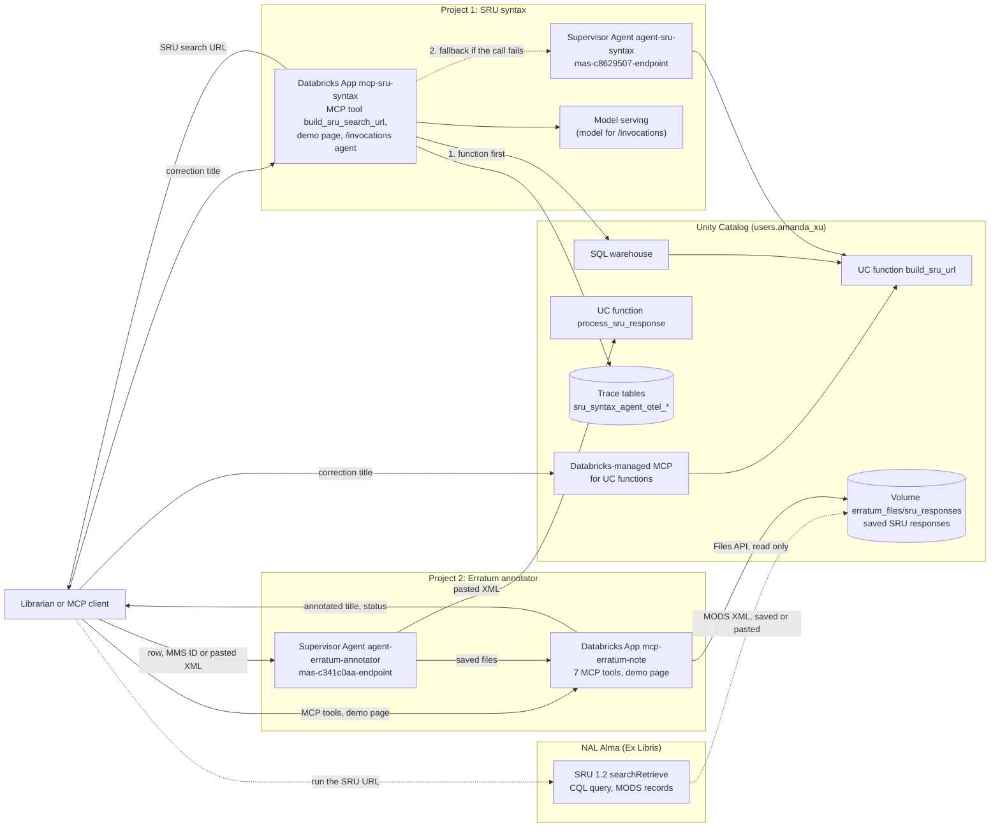

# NAL Metadata Support: automating PubAg correction processing

Databricks MCP Hackathon project from the USDA National Agricultural Library (NAL).

Publishers issue correction notices (errata, corrigenda, addenda) for articles indexed in PubAg. Each notice
has its own catalog record, and staff must find the **original article** it corrects. Today that means
reading the notice title, working out the original article title by hand, and searching NAL's Alma catalog.

This project is the initial stage of automating that workflow:

1. **Part 1, spreadsheet processing:** extract the original article title from each correction notice title
   and build an Alma SRU search URL for it.
2. **Part 2, agents, MCP and governance on Databricks:** make the same logic available to people and AI
   agents as a governed Unity Catalog function, a Supervisor Agent and an MCP server, with tracing and
   evaluation.
3. **Part 3, erratum annotation:** from the SRU response, find the original article's record and append an
   erratum note to its title, with a second MCP server and agent ([`erratum-annotator/`](erratum-annotator/README.md)).

## At a glance: two MCP apps, two agents

| | Project 1: SRU syntax (Parts 1 and 2) | Project 2: Erratum annotator (Part 3) |
| --- | --- | --- |
| What it does | Correction notice title -> NAL Alma SRU search URL | SRU response (MODS XML) -> original title with `[Erratum: ...]` note |
| MCP server (Databricks App) | `mcp-sru-syntax`: 1 tool, `build_sru_search_url` | `mcp-erratum-note`: 7 tools, e.g. `list_sru_files`, `process_sru_file` |
| Agent | Supervisor Agent `agent-sru-syntax` (`mas-c8629507-endpoint`); the app also serves an OpenAI Agents SDK agent at `/invocations` | Supervisor Agent `agent-erratum-annotator` (`mas-c341c0aa-endpoint`), [configuration](erratum-annotator/agent/README.md) |
| Deterministic rules | UC function `users.amanda_xu.build_sru_url` | UC function `users.amanda_xu.process_sru_response` |
| Code | Repo root: [`src/sru_server/`](src/sru_server/), [`databricks.yml`](databricks.yml) | [`erratum-annotator/`](erratum-annotator/README.md) |
| Evaluation | [`eval/`](eval/README.md): Inspector Gadget MCP tests, MLflow evaluation ([`databricks/`](eval/databricks/README.md)), Phoenix agent evaluation ([`phoenix/`](eval/phoenix/README.md)); [report PDF](submission/sru-syntax-mcp-evaluation-report.pdf) | [`erratum-annotator/eval/databricks/`](erratum-annotator/eval/databricks/README.md), [report PDF](erratum-annotator/eval/databricks/doc/agent-erratum-annotator-evaluation-report.pdf) |
| Headline result | 135/142 correct replies via MCP, 0 wrong URLs | Agent: 50/53 exact annotated titles; MCP server alone: 0 errors, 48/48 original MMS IDs |
| Deploy | Declarative Automation Bundle `sru_syntax` | `databricks apps deploy` from `erratum-annotator/mcp_server` |

See [Deploying the two apps safely](#deploying-the-two-apps-safely) and [`submission/`](submission/README.md).

```
Correction notice title (Sample 1, row 43; erratum MMS ID 9917175550407426)
  "Publisher Correction: DNMT3A/TET2-mediated epigenetic alteration in Type-1 diabetes dysregulates the haematopoiesis"
        |
        v  title extraction rules (Part 1)
Original article title
  "DNMT3A/TET2-mediated epigenetic alteration in Type-1 diabetes dysregulates the haematopoiesis"
        |
        v  SRU URL builder (Part 2, mcp-sru-syntax)
https://nal.alma.exlibrisgroup.com/view/sru/01NAL_INST?version=1.2&operation=searchRetrieve&recordSchema=mods&query=alma.title%3D%22DNMT3A%2FTET2-mediated%20epigenetic%20alteration%20in%20Type-1%20diabetes%20dysregulates%20the%20haematopoiesis%22%20and%20alma.local_field_912%3D%22Article%22
        |
        v  run the SRU search in Alma; save the response (MODS XML) to the volume, or paste it
SRU searchRetrieveResponse (MODS XML): 2 records
  correction notice  9917175550407426
  original article   9917168304707426
        |
        v  erratum annotation (Part 3, mcp-erratum-note)
        |    process_sru_file("Sample1-Row43-9917175550407426.xml")  (or process_sru_response for pasted XML)
        |    1. parse_sru_response    records: title, MMS ID, <part><text>, DOI, is_correction
        |    2. match                 correction record (erratum MMS ID) -> original article
        |                             (cited DOI first, then title similarity; else needs_review)
        |    3. extract_erratum_note  "[Erratum: Dec. 2026, v. 53, no. 1, 1310, 10.1007/s11033-026-12468-5]"
        |    4. enhance_title         append the note; titles that already have "[Erratum:" stay unchanged
        v
Annotated original title (original MMS ID 9917168304707426, needs_review = false)
  "DNMT3A/TET2-mediated epigenetic alteration in Type-1 diabetes dysregulates the haematopoiesis [Erratum: Dec. 2026, v. 53, no. 1, 1310, 10.1007/s11033-026-12468-5]"
```

## Playground demo: both MCP apps on one correction notice

Judges can repeat this demo in the Databricks **AI Playground**. Both prompts use the same correction notice:
MMS ID `9917175652607426` (Sample 1, row 42). Its title has a Unicode hyphen (U+2010) in "Climate‐driven".
Paste each prompt as written. Both were checked on November 23, 2026: each reply matched the ground truth in
`Correction-Sample1-53-annotated.csv`.

| Step | App | Playground pane (serving endpoint) | Tool called | Time |
| --- | --- | --- | --- | --- |
| 1 | `mcp-sru-syntax` | `agent-sru-syntax` (`mas-c8629507-endpoint`) | `users__amanda_xu__build_sru_url` | 50 s |
| 2 | `mcp-erratum-note` | `agent-erratum-annotator` (`mas-c341c0aa-endpoint`) | `process_sru_file` (MCP) | 13 s |

**Prompt 1 (`mcp-sru-syntax`, build the SRU search URL):**

```text
Build the Alma SRU search URL for correction notice MMS ID 9917175652607426. Correction notice title: Correction to: Climate‐driven insect pest outbreaks and food security risks: a review of adaptive strategies for resilient agriculture
```

Expected: the reply gives this URL (it matches the ground-truth `sru_url` character for character):

```text
https://nal.alma.exlibrisgroup.com/view/sru/01NAL_INST?version=1.2&operation=searchRetrieve&recordSchema=mods&query=alma.title%3D%22Climate-driven%20insect%20pest%20outbreaks%20and%20food%20security%20risks%3A%20a%20review%20of%20adaptive%20strategies%20for%20resilient%20agriculture%22%20and%20alma.local_field_912%3D%22Article%22
```

**Prompt 2 (`mcp-erratum-note`, annotate the original title from the saved SRU response):**

```text
Annotate the original article for correction notice MMS ID 9917175652607426. Correction notice title: Correction to: Climate‐driven insect pest outbreaks and food security risks: a review of adaptive strategies for resilient agriculture. The saved SRU response file is Sample1-Row42-9917175652607426.xml. Return the annotated original title, the erratum note, the original MMS ID, and whether it needs manual review.
```

Expected:

* Annotated title: `Climate-driven insect pest outbreaks and food security risks: a review of adaptive strategies for resilient agriculture [Erratum: Sept. 2026, v. 99, no. 3, 111, 10.1007/s10340-026-02069-3]`
* Original MMS ID: `9917015258907426`
* Needs manual review: No

Notes:

* The two steps run in order. Prompt 1 gives the SRU URL. The librarian runs that URL in Alma and saves the response.
  For this notice the response is already saved as
  `/Volumes/users/amanda_xu/erratum_files/sru_responses/Sample1-Row42-9917175652607426.xml`. Prompt 2 reads that file.
* In pane 2, approve the `mcp-erratum-note` tool call when the Playground asks. The reply arrives after approval.
* Pane 1 talks to `agent-sru-syntax`, the Supervisor Agent behind the `mcp-sru-syntax` tool `build_sru_search_url`. It calls the same rules function
  (`users.amanda_xu.build_sru_url`) that the tool calls first. To call the MCP app itself, open a model pane, choose
  **Tools > MCP servers > Databricks Apps**, add `mcp-sru-syntax` (and `mcp-erratum-note` for step 2), then send the same prompt.

## How the system works

Short answers to common design questions. Details are in each project's README.

**Components.** Solid arrows are calls; dotted arrows are manual steps by the librarian.



**What data does it ingest, and how?**

* Correction notice records exported from Alma as a spreadsheet (`Title`, `MMS ID`). They are processed by
  the Part 1 script, or in SQL with the UC function `users.amanda_xu.build_sru_url`.
* Single correction notice titles typed by a librarian or sent by an agent to the MCP tool
  `build_sru_search_url`, the demo page or `/invocations`.
* SRU search responses (MODS XML) from NAL Alma. The SRU search is not run automatically. A librarian runs it
  and either saves the response in the volume `/Volumes/users/amanda_xu/erratum_files/sru_responses` or pastes
  it into the erratum annotator.

**How does it store and retrieve knowledge?**

* The domain knowledge is deterministic rules, not a vector index or a trained model. The title extraction
  and URL rules live in `build_sru_url`. The SRU parsing, matching and note rules live in
  `erratum-annotator/mcp_server/erratum_annotator.py`, which also becomes the UC function
  `process_sru_response`. Both are versioned in Git.
* Data lives in Unity Catalog: saved SRU responses in the volume `users.amanda_xu.erratum_files`, which
  `list_sru_files` and `process_sru_file` read through the Files API, and agent traces in the
  `users.amanda_xu.sru_syntax_agent_otel_*` tables.
* Catalog records stay in Alma and are looked up through SRU; the system does not keep its own copy.

**How are multiple components or agents coordinated?**

* There are two steps: correction title, then SRU URL (Project 1), then annotated original title (Project 2).
  A librarian runs the SRU search in Alma between the two steps.
* In each project, a Supervisor Agent routes the request to tools. `agent-sru-syntax` calls `build_sru_url`.
  `agent-erratum-annotator` calls the `mcp-erratum-note` MCP server for saved files and the UC function for
  pasted XML.
* `mcp-sru-syntax` runs the UC function on a SQL warehouse first and asks the Supervisor Agent only if that
  call fails.
* The MCP tools and the UC functions run the same code, so every path gives the same answer.

**What reasoning does it perform?**

* Rule-based, deterministic steps: strip notice wording and citations from the correction title,
  percent-encode a CQL query, parse MODS records, and pick the original article. Picking the original
  excludes correction records, scores title similarity and gives a cited DOI the win outright. A weak or tied
  match is flagged `needs_review`. Finally the steps format the `[Erratum: ...]` note and add it to the title.
* The LLM agents choose tools, check inputs (for example, 16-digit MMS IDs) and explain results. Their
  instructions forbid them from writing URLs, erratum notes or titles themselves.

**What external tools or APIs does it call?**

* Databricks SQL Statement Execution API, on a SQL warehouse, to run `build_sru_url`.
* Model Serving endpoints for the Supervisor Agents (`mas-c8629507-endpoint`, `mas-c341c0aa-endpoint`) and for
  the model behind the `/invocations` agent.
* The Unity Catalog Files API, to read the saved SRU responses.
* MLflow, for tracing and evaluation, and the Databricks-managed MCP server for Unity Catalog functions.

**What other systems, agencies or protocols must it connect to?**

* NAL's Alma catalog (Ex Libris), through SRU 1.2 `searchRetrieve` with CQL queries and the MODS record
  schema. Alma is the source of the correction records and the original article records for PubAg.
* Model Context Protocol (streamable HTTP at `/mcp`), so any MCP client or agent can use the tools.
* Databricks OAuth for the apps (personal access tokens are rejected) and Unity Catalog permissions for
  functions, volumes and traces. Running SRU searches live from the apps would also need USDA eAuth access to
  Alma, which is not yet in place.

**How does it detect and recover from errors?**

* Inputs are checked before any tool runs: empty or too-long text, 16-digit MMS IDs, bare `.xml` file names,
  XML that is cut off or not SRU, and Alma SRU diagnostics.
* Each error returns a stable category (for example `invalid_input`, `not_well_formed`, `timeout`,
  `unavailable`, `permission_denied`, `empty_reply`) and an error ID. The message says what to do next. Logs
  record the ID and category, never titles or XML.
* Results carry a `status` (`ready`, `needs_review`, `no_original`, `no_records`, `no_note` and others) and
  `warnings`, so an empty result is never taken for a good one. The agent instructions map each category to
  one action: ask for complete XML, retry once, or report the error ID.
* Tests (`erratum-annotator/tests/`) and MLflow evaluations of both agents catch regressions before and after
  a deploy.

**What keeps it working during disruptions?**

* Fallbacks: if the SQL warehouse call fails, `mcp-sru-syntax` asks the Supervisor Agent. If
  `mcp-erratum-note` is unavailable twice, the agent uses the UC function for pasted XML. For bulk work, the UC
  functions run in SQL without either app.
* Short, bounded retries: a busy (429) or unavailable (502/503) agent is retried once after its Retry-After
  time, capped at 10 s, and timeouts are not retried. Volume reads are retried once.
* Start-up warm-up of the UC function and `health` checks on both apps, including access to the saved
  responses.
* The `/invocations` agent's model is set by configuration (`AGENT_MODEL`), so it can move to a
  Databricks-hosted model when the default model service fails.
* Deployment as code, with updates in place: apps are updated, not recreated. An offline demo page
  ([`erratum-annotator/demo/`](erratum-annotator/demo/README.md)) works with no account or network.

### How it meets multi-agent system requirements

A single agent asked to read a notice, write a CQL query, parse MODS XML and format a note would have to hold
the whole workflow in one long prompt, and would make up URLs or notes when unsure. This system splits the work
into two specialised agents, two MCP apps and deterministic functions. Each agent does one short task and leaves
the exact work to tools. It is a small, two-stage system, not an open-ended agent swarm.

| Requirement | How the MCP apps and the two agents meet it |
| --- | --- |
| Specialisation | `agent-sru-syntax` only turns a correction title into an SRU URL. `agent-erratum-annotator` only turns an SRU response into an annotated title. Each has a narrow set of instructions and its own tools. |
| Orchestration | Each Supervisor Agent (Agent Bricks) chooses which tool to call. `mcp-sru-syntax` orchestrates in code: the UC function first, the Supervisor Agent only if that call fails. Between the two stages, a librarian runs the SRU search in Alma, so a person checks each handoff. |
| Coordination | The stages share no state. They are linked by data: the SRU URL from stage 1 and the saved SRU response used by stage 2, keyed by the correction's MMS ID. Both tool paths in each project run the same code (the MCP tools and the UC functions), so agents and SQL users always agree. |
| Communication | Model Context Protocol over streamable HTTP (`/mcp`) between agents and tools; the Responses API format at `/invocations`; Databricks OAuth on every call. Tool results are structured (URL, `status`, `warnings`, error category and ID), not free text. |
| Distributed computation | The work runs on separate managed services: two Databricks Apps, Model Serving endpoints for the agents, a SQL warehouse for the UC functions and a Unity Catalog volume for the saved responses. Each can scale or fail on its own. |
| Scalability | The tools keep no state between calls (`mcp-sru-syntax` runs stateless streamable HTTP), so requests run in parallel. 142 titles sent 10 at a time to the MCP tool finished in 79 s, all answered by the function. Bulk work skips the agents: the UC function processes the 1,494-record sample in SQL. |
| Fault tolerance | Fallbacks (function to agent; MCP app to UC function), one short retry for temporary errors, health checks, a warm-up call at start-up, and stable error categories with error IDs. See the two answers above on errors and disruptions. |
| Decision-making | The decisions that must be exact are made by deterministic rules: title extraction, URL encoding, choosing the original record (cited DOI, then title similarity), and flagging weak or tied matches as `needs_review`. The agents decide only which tool to call, whether an input is usable (for example a 16-digit MMS ID), and how to explain the result or the error. |
| Memory | The system has no conversational long-term memory. Its knowledge is the rules, versioned in Git and governed as UC functions. Its working data is in Unity Catalog: the volume of saved responses, the trace tables for every agent and tool call, and the MLflow evaluation runs. Each request carries everything the agent needs, so no long-horizon reasoning is required. |
| Security | OAuth-only apps (callers need `CAN USE`), least-privilege service principals declared as resources, read-only tools, bare file names only, `allow_redirects=False` on outbound calls, no secrets in Git, and logs that record error IDs but never titles or XML. The erratum agent's MCP calls require approval in the chat. |

## Repository layout

| Folder | What it is |
| --- | --- |
| [`src/sru_server/`](src/sru_server/) | Part 2: the MCP server and agent code, adapted to the GSA MCP hackathon template structure (`app.py`, `agent.py`, `tools/build_sru_url.py`, `config.py`). |
| [`sru-syntax-mcp/`](sru-syntax-mcp/README.md) | Part 2, as deployed: byte-identical copy of the live `mcp-sru-syntax` source (`mcp_server/`) and the UC function `build_sru_url` (`uc_functions/`). Tools and functions are listed in [`deploy/databricks/README.md`](deploy/databricks/README.md#tools-and-functions). |
| [`title-extraction/`](title-extraction/README.md) | Part 1: `erratum_title_extractor.py`, the spreadsheet processing script. |
| [`deploy/databricks/`](deploy/databricks/README.md) | Deployment runbook: how to deploy the MCP server as a Databricks App using a Declarative Automation Bundle. |
| [`eval/`](eval/README.md) | All evaluation methods, indexed in [`eval/README.md`](eval/README.md) with their status in [`EVALUATION_FRAMEWORK.md`](eval/EVALUATION_FRAMEWORK.md): the Inspector Gadget MCP test suite for both live apps (`inspector_gadget/`), MLflow GenAI evaluation over labelled notices (`databricks/`), the Phoenix harness that scores an agent using the MCP server (`phoenix/`), committed run results (`results/`), the demo runbook (`demo/`) and the usability review (`usability/`). |
| [`tests/`](tests/) | Smoke tests and SSRF hardening regression tests for the MCP server. |
| [`.agents/skills/agent-sru-syntax/`](.agents/skills/agent-sru-syntax/SKILL.md) | Coding-agent skill: instructions and SRU URL rules for agents working on this project. |
| [`databricks.yml`](databricks.yml) | Declarative Automation Bundle: defines the app, its resources, and variables. |
| [`resources/`](resources/check_live.job.yml) | Bundle job `check_live`: the daily read-only check of both live apps ([`scripts/check_live.py`](scripts/README.md#check-the-live-apps)). |
| [`setup/`](setup/create_uc_backed_experiment.py) | One-time setup: create a Unity Catalog-backed MLflow experiment for trace storage. |
| [`mcp_server/`](mcp_server/) | App runtime config (`app.yaml`, `requirements.txt`) used by the bundle deploy. |
| [`erratum-annotator/`](erratum-annotator/README.md) | Part 3, self-contained: MCP server `mcp-erratum-note` (`mcp_server/`), agent `agent-erratum-annotator` configuration (`agent/`), UC function definitions (`uc_functions/`), evaluation, Inspector Gadget test and report (`eval/databricks/`). |
| [`submission/`](submission/README.md) | Hackathon deck, both evaluation reports and the librarian quick-start. |
| [`scripts/`](scripts/README.md) | Command-line scripts for routine jobs: add a new SRU response sample, recreate a UC function and keep its grants, copy changes from the NAL repo, check both live apps. |

## Part 1: Spreadsheet processing

**Input:** an Alma export of correction notice records. The main sample,
`Correction-Sample2-1494-20261021.xlsx`, has 1,494 records with `Title` and `MMS ID` columns.

**Code:** [`title-extraction/erratum_title_extractor.py`](title-extraction/README.md)
(`python erratum_title_extractor.py INPUT.xlsx`; needs `pandas` and `openpyxl`).

**Output:** the same records with these columns, as a downloadable Excel workbook:

| Column | Name | Contents |
| --- | --- | --- |
| A | `erratumn_article_title` | Correction notice title, as exported |
| B | `extracted_title` | Original article title after the extraction rules |
| C | `erratum_MMSID` | MMS ID of the correction notice record |
| D | `extracted_title_clean` | Extracted title after normalisation (dashes, quotes, spaces) |
| E | `SRU_Query_Syntax` | CQL query: `alma.title="<title>" and alma.local_field_912="Article"` |
| F | `SRU_Full_URL` | Full SRU searchRetrieve URL |
| G | `extraction_rule` | QA column: which rule produced the title |

The column name `erratumn_article_title` is kept as-is for compatibility with existing files.

### Title extraction rules

The rules were built up iteratively on real notices:

1. Remove notice prefixes such as `Correction:`, `Correction to:` and `Publisher Correction:`.
2. Parse the embedded article title out of bibliographic `Corrigendum:` and `Corrigenda:` notices of the form
   `Corrigendum: Author1, Author2, ... (2026) Original article title. Journal Title 123: 45-67. https://doi.org/...`.
   Remove the prefix, author list, year, journal title, volume/issue/page information and DOI, and keep only
   the original article title.
3. Handle the other notice patterns found in the data: quoted titles, cited authors
   (`Correction for Kuo and Chang, <title>`), quoted full citations, trailing citations
   (`... by Lee et al. Journal 2024;27(6):488-501; doi: ...`), notice suffixes (`<title>/Correction`), and
   titles with no notice wording.
4. Leave the title blank, so no URL is built, when the notice names no single article: bare notices
   (`Correction`, `ERRATA`) and issue-level notices (`Taxon 61(6)`, `Correction for Data Papers Published in 2020`).
5. Guard against false positives: a real title such as `Correction of hypocalcemia in dairy cows` is kept.

**Journal-agnostic corrigendum parsing.** Corrigendum citations use many journal names and formats. Instead of
listing journals, the extractor takes the text immediately after the year `(YYYY)` and cuts it at the first
journal citation segment, so it also works for journals that are not in the sample.

The full rule table, with an example and rule name for each case, is in
[`.agents/skills/agent-sru-syntax/references/sru_url_rules.md`](.agents/skills/agent-sru-syntax/references/sru_url_rules.md).

### SRU URL format

Template (one line, no spaces or line breaks; replace `<title>` with the percent-encoded title):

```
https://nal.alma.exlibrisgroup.com/view/sru/01NAL_INST?version=1.2&operation=searchRetrieve&recordSchema=mods&query=alma.title%3D%22<title>%22%20and%20alma.local_field_912%3D%22Article%22
```

Working example, for the title "The cardiovascular effects of shechita in cattle: a systematic review shows the fallacies that vertebral artery will preserve cerebral blood flow and false aneurysms occur in severed carotid arteries":

```
https://nal.alma.exlibrisgroup.com/view/sru/01NAL_INST?version=1.2&operation=searchRetrieve&recordSchema=mods&query=alma.title%3D%22The%20cardiovascular%20effects%20of%20shechita%20in%20cattle%3A%20a%20systematic%20review%20shows%20the%20fallacies%20that%20vertebral%20artery%20will%20preserve%20cerebral%20blood%20flow%20and%20false%20aneurysms%20occur%20in%20severed%20carotid%20arteries%22%20and%20alma.local_field_912%3D%22Article%22
```

* Production Alma (`nal.alma...`). The sandbox (`nal-psb.alma...`) does not hold the production records.
* The whole query is percent-encoded (spaces as `%20`, not `+`); there is no `maximumRecords` parameter.
* `"` and `\` inside a title are replaced with spaces so they cannot end the CQL quoted term.

### Results on the 1,494-record sample

* 1,384 records get an SRU URL; 110 are bare or issue-level notices with no single article, so no URL is built.
* The Unity Catalog function (below) reproduces the extractor's output for all 1,494 records.
* A URL that returns a valid SRU response with 0 records means the article was not found in Alma, not a
  syntax problem.

## Part 2: Agents, MCP and governance on Databricks

### Components

| Component | What it does |
| --- | --- |
| Unity Catalog function `users.amanda_xu.build_sru_url(correction_title)` | Python UDF with the Part 1 rules. Deterministic; the source of truth for SRU URLs. Use it for bulk processing in SQL. |
| Supervisor Agent `agent-sru-syntax` (endpoint `mas-c8629507-endpoint`) | Agent Bricks agent that calls the function as a tool. |
| Databricks App `mcp-sru-syntax` | Custom MCP server with one read-only tool, `build_sru_search_url`, that runs the function on a SQL warehouse first (about 4 s) and asks the Supervisor Agent only if that call fails. The same app serves an OpenAI Agents SDK agent at `/invocations` that uses the tool. See [`deploy/databricks/README.md`](deploy/databricks/README.md). |
| Agent skill `agent-sru-syntax` | Instructions and rules for coding agents working on this project ([`SKILL.md`](.agents/skills/agent-sru-syntax/SKILL.md)). |
| Evaluation | Inspector Gadget MCP tests of the live app, MLflow GenAI evaluation over labelled notices, and a Phoenix evaluation of an agent that uses the MCP server ([`eval/`](eval/README.md)). |

For bulk work, call the function from SQL. The MCP tool and the browser page answer in about 4 seconds
per title (live test 2026-11-21: 3.9-4.7 s), because they run the function first; the Supervisor Agent
(about 20 seconds per title) is only the fallback. Either way they suit interactive use rather than
thousands of rows.

### The MCP server (`src/sru_server/`)

The server is built on MCP 1.x (`mcp.server.fastmcp`) and serves stateless streamable-HTTP. The workspace
is at its 100-app limit, so the MCP server and the agent share the `mcp-sru-syntax` app:

| Endpoint | Code | What it does |
| --- | --- | --- |
| `/mcp` | `src/sru_server/app.py` | MCP server (streamable HTTP) with one tool, `build_sru_search_url`: runs `users.amanda_xu.build_sru_url` on a SQL warehouse first (about 4 s) and falls back to the agent-sru-syntax Supervisor Agent endpoint `mas-c8629507-endpoint` |
| `POST /invocations`, `POST /responses` | `src/sru_server/agent.py` | OpenAI Agents SDK agent that uses the `/mcp` tool over localhost |
| `GET /health` | `src/sru_server/app.py` | Liveness check |

The tool implementation is in [`src/sru_server/tools/build_sru_url.py`](src/sru_server/tools/build_sru_url.py).
It runs the governed function `users.amanda_xu.build_sru_url` on the SQL warehouse in `SQL_WAREHOUSE_ID`
first (title as a bound parameter; about 4 s). If the function finds no single original article, the tool
says so at once. Only if the function call fails does it send the title to the Supervisor Agent. It returns
the SRU URL and handles agent errors with stable
categories (`invalid_input`, `timeout`, `unavailable`, `rate_limited`, `permission_denied`, `not_found`,
`bad_request`, `bad_response`, `empty_reply`, `internal`) and an error ID instead of leaking upstream response
bodies. Each message says what to do next. An empty reply, a busy agent (429) or a temporary outage
(502/503, connection error) is retried once, after the agent's Retry-After or 2 s (at most 10 s); timeouts and
permission or configuration errors are not retried. If the reply is still empty after the retry, the tool
returns the `empty_reply` error, which points to the SQL function for that title.

### Two ways to reach the logic over MCP

**1. Databricks-managed MCP server for Unity Catalog functions (no hosting).** Databricks exposes Unity
Catalog functions as MCP tools at:

* `https://<workspace-host>/api/2.0/mcp/functions/{catalog}/{schema}`: every function in the schema
* `https://<workspace-host>/api/2.0/mcp/functions/{catalog}/{schema}/{function_name}`: one function

A workspace admin must enable Managed MCP Servers on the workspace Previews page. Clients request the
`unity-catalog` OAuth scope.

From a Databricks notebook, using `DatabricksMCPClient` from the `databricks-mcp` package:

```python
%pip install databricks-mcp nest_asyncio
```

```python
import nest_asyncio
nest_asyncio.apply()  # the client runs asyncio internally; this lets it run inside the notebook's event loop

from databricks.sdk import WorkspaceClient
from databricks_mcp import DatabricksMCPClient

ws = WorkspaceClient()  # authenticated as the notebook user
server_url = f"{ws.config.host}/api/2.0/mcp/functions/users/amanda_xu/build_sru_url"
client = DatabricksMCPClient(server_url=server_url, workspace_client=ws)

print([t.name for t in client.list_tools()])  # ['users__amanda_xu__build_sru_url']
result = client.call_tool(
    "users__amanda_xu__build_sru_url",
    {"correction_title": "Correction: Lorazepam reduces recurrence of urethral obstruction in male cats"},
)
print(result.content[0].text)  # JSON with the SRU URL in rows[0][0]
```

Tool names are the function's full name with `__` in place of dots. The schema-level URL also lists
`build_sru_url_v1`, an older version, so use the function-level URL to expose only the current function.
The first call can time out while the function warms up; retry once.

**2. Custom MCP server on Databricks Apps (`mcp-sru-syntax`).** Managed MCP has no endpoint for
Supervisor Agents, so the app wraps the agent in an MCP tool:
`https://mcp-sru-syntax-7474654188777746.aws.databricksapps.com/mcp`. Databricks Apps require an OAuth token;
personal access tokens are rejected. See [`deploy/databricks/README.md`](deploy/databricks/README.md) for
full deployment instructions.

### Deploy

The live app and the daily `check_live` job are deployed from this repo's `prod` target,
the only bundle that manages them (the app was unbound from the NAL repo's bundle on
2026-11-22). Run from the repo root (the bundle root), on `main`:

```bash
databricks bundle validate --strict -t prod
databricks bundle plan -t prod        # must say "update apps.sru_syntax_mcp", never "create"
databricks bundle deploy -t prod
databricks bundle run sru_syntax_mcp -t prod   # deploys the app code
```

Do not `bundle deploy -t dev` here for the live app: the `dev` target does not track it
and would try to create a second `mcp-sru-syntax` app. Override any variable with
`--var`, for example `--var model_service=models.ai.gpt-5-6-sol`. Details:
[`deploy/databricks/README.md`](deploy/databricks/README.md#production-target-prod).

### Test the agent

```bash
curl -X POST "https://mcp-sru-syntax-7474654188777746.aws.databricksapps.com/invocations" \\
  -H "Authorization: Bearer <OAUTH_TOKEN>" -H "Content-Type: application/json" \\
  -d '{"input": [{"role": "user", "content": "Correction: <article title>"}]}'
```

Apps require an OAuth token (`databricks auth token`); personal access tokens are not accepted.
The tool itself answers in about 4 seconds (SQL function first); with the agent's own model calls a title
takes about 7-10 seconds (live test 2026-11-21: 6.6-10.1 s), and a bare or issue-level notice about 1 second.
The agent uses the Databricks-hosted model endpoint `databricks-gpt-5-6-luna` (`AGENT_MODEL` in `app.yaml`).

### App resources

The bundle ([`databricks.yml`](databricks.yml)) declares these app resources, and the app's service principal gets each permission.
Three of them reach the app as environment variables through `valueFrom` in [`mcp_server/app.yaml`](mcp_server/app.yaml); the others are
permission grants only.

| Resource | Permission | Environment variable |
| --- | --- | --- |
| `serving-endpoint`: Supervisor Agent endpoint | `CAN_QUERY` | `SERVING_ENDPOINT` (`valueFrom`) |
| `model-service`: Unity Gateway model service (default `models.ai.gpt-5-6-luna`) | `EXECUTE` | `MODEL_SERVICE` (`valueFrom`) |
| `app-experiment`: Unity Catalog-backed experiment | `CAN_EDIT` | `MLFLOW_EXPERIMENT_ID` (`valueFrom`) |
| `sql-warehouse`: the warehouse that runs `build_sru_url` | `CAN_USE` | `SQL_WAREHOUSE_ID`, set as a plain value in `app.yaml` |
| `sru-function`: `users.amanda_xu.build_sru_url` | `EXECUTE` | none |
| `trace-annotations`, `trace-logs`, `trace-metrics`, `trace-spans`: the four `users.amanda_xu.sru_syntax_agent_otel_*` tables | `MODIFY` (includes `SELECT`) | none; lets MLflow write the app's traces to these tables |

### Governance

* **Unity Catalog permissions.** Callers need `USE CATALOG`, `USE SCHEMA` and `EXECUTE` on the function. The
  app's service principal gets only the resources declared in the bundle: `CAN_QUERY` on the Supervisor Agent
  endpoint, `CAN_USE` on the SQL warehouse, `EXECUTE` on `users.amanda_xu.build_sru_url`, `EXECUTE` on the
  model service, `CAN_EDIT` on the experiment and `MODIFY` on the trace tables.
* **Deployment as code.** The app, its resources and permissions are defined in a Declarative Automation
  Bundle ([`databricks.yml`](databricks.yml)).
* **Tracing in Unity Catalog.** MLflow traces every agent, model and tool call into
  `users.amanda_xu.sru_syntax_agent_otel_*` tables, so traces are governed and queryable like any other table.
* **Safe tool behaviour.** The MCP tool is annotated read-only and idempotent, and returns stable error
  categories with an error ID instead of upstream error bodies. The outbound HTTP call uses
  `allow_redirects=False` to prevent SSRF via redirects.
* **Evaluation.** Offline MLflow GenAI evaluation checks URLs and agent behaviour over 41 labelled
  notices (5 scorers: `sru_url_match`, `correctness`, `relevant_to_notice`, `no_invented_urls`, `safety`).
  Online monitoring uses two registered custom scorers (`ToolCallEfficiency`, `ToolCallCorrectness`)
  that score live traces automatically when started. Both are currently stopped (0% sample rate).
  A Phoenix harness ([`eval/phoenix/`](eval/phoenix/README.md)) scores a separate agent that uses only the
  MCP server, with an exact URL check and two LLM judges, on 10 gold and 4 out-of-scope questions.
  See [`eval/`](eval/README.md) for all evaluation methods and the
  [evaluation report](submission/sru-syntax-mcp-evaluation-report.pdf).

### Tracing

`mlflow.openai.autolog()` traces every model and MCP tool call automatically. `run_agent` adds an
`AGENT` span plus a `preprocessing` child span.

Traces are stored in Unity Catalog under `users.amanda_xu`:

* `sru_syntax_agent_otel_spans`, `_otel_logs`, `_otel_metrics`, `_otel_annotations` (tables)
* `sru_syntax_agent_trace_unified`, `sru_syntax_agent_trace_metadata` (views)

[`setup/create_uc_backed_experiment.py`](setup/create_uc_backed_experiment.py) created the experiment and
tables (already run once). To use a different location, run it with new names and set
`trace_experiment_id` / `trace_table_prefix` in [`databricks.yml`](databricks.yml).

## Part 3: Erratum annotation

Once the SRU search returns the original article and its correction notice, [`erratum-annotator/`](erratum-annotator/README.md)
picks the original record (cited DOI first, then title similarity), builds the erratum note from the correction
record and appends it to the original title, for example
`<original title> [Erratum: Aug. 2026, v. 52, no. 4, 134, 10.1007/s10695-026-01767-0]`. Titles that already carry
a note are returned unchanged; uncertain matches are flagged `needs_review`.

* **MCP server `mcp-erratum-note`** ([`erratum-annotator/mcp_server/`](erratum-annotator/mcp_server/)): 7 read-only
  tools; `process_sru_file` reads saved SRU responses from a Unity Catalog volume.
* **Agent `agent-erratum-annotator`**: Supervisor Agent with the MCP server and the UC function
  `process_sru_response` (generated from the same Python file) as tools.
* **Evaluation** ([`erratum-annotator/eval/databricks/`](erratum-annotator/eval/databricks/README.md)): MLflow
  evaluation of the agent on the 53-row Sample1 set (annotated_title_exact 50/53, erratum_note_exact 52/53,
  original MMS ID 45/46) and a direct Inspector Gadget test of the MCP server (48 files, 0 errors, 46/48 titles
  with the 2 expected differences, 48/48 MMS IDs, median 0.28 s per call).

The live `mcp-erratum-note` app is deployed from the same folder in NAL's repository; this copy is kept
byte-identical.

## Deploying the two apps safely

The two projects deploy independently: neither deploy touches the other app, agent or permissions.

| | `mcp-sru-syntax` | `mcp-erratum-note` |
| --- | --- | --- |
| How | Bundle `sru_syntax`, target `prod`, from the repo root (see [Deploy](#deploy)) | `databricks apps deploy mcp-erratum-note --source-code-path <repo>/erratum-annotator/mcp_server` |
| App service principal gets | `CAN_QUERY` on `mas-c8629507-endpoint`, `CAN_USE` on the SQL warehouse, `EXECUTE` on `build_sru_url` and on the model service, `CAN_EDIT` on the experiment, `MODIFY` on the trace tables | `READ VOLUME` on `users.amanda_xu.erratum_files` only |
| Check after deploy | [`eval/databricks/inspector_gadget_mcp_test.py`](eval/databricks/inspector_gadget_mcp_test.py) | `erratum-annotator/eval/databricks/mcp-erratum-note Inspector Gadget Test` (expect 0 errors, 46/48, 48/48) |

* **Update in place, never recreate.** The workspace is at its 100-app limit and both apps already exist. Run
  `databricks bundle plan -t prod` first: it must say `update apps.sru_syntax_mcp`, never `create`. Only this
  repo's `prod` target manages the app; do not bind it to another bundle or target. Never rename the bundle
  resource key `sru_syntax_mcp` without unbinding and rebinding, or the next deploy would delete the app.
* **Callers need CAN USE.** Both apps are OAuth-gated by Databricks Apps. The test service principal
  (Inspector Gadget) has CAN USE on both; its credentials stay in the Unity Catalog secret
  `models.ai/inspector-gadget`, never in Git.
* **Supervisor Agents are configured in Agent Bricks**, not in a bundle, so redeploying an app never changes
  an agent. The `agent-erratum-annotator` tools and instructions are in
  [`erratum-annotator/agent/README.md`](erratum-annotator/agent/README.md) so it can be recreated.
* **Keep one source of rules.** Each project's deterministic rules are a governed UC function, and the agents
  call tools instead of writing answers themselves. For Project 2, `process_sru_response` is generated from
  `erratum-annotator/mcp_server/erratum_annotator.py`: regenerate it whenever that file changes
  (`erratum-annotator/uc_functions/build_uc_functions.py`), then rerun the evaluation. Both projects' function
  definitions are in Git (`sru-syntax-mcp/uc_functions/`, `erratum-annotator/uc_functions/`).

## Tests

* [`tests/test_server.py`](tests/test_server.py) -- smoke tests: server import, name, default transport, tool registration, `build_sru_search_url` discoverability.
* [`tests/test_http_security.py`](tests/test_http_security.py) -- SSRF hardening: `allow_redirects=False`, fixed endpoint URL (not user-controlled), user input in JSON body (not URL), error sanitization, stable error categories.
* [`tests/test_scripts.py`](tests/test_scripts.py) -- the four [`scripts/`](scripts/README.md): sample checks and no-overwrite uploads, grant restore after a UC function recreate, safe NAL-to-fork copies (each status, on scratch git repos), and the live-app checks (MCP client and pass/fail reporting, with faked apps).

## Status and next steps

* Done: extraction rules, Unity Catalog function, Supervisor Agent, MCP server app, Unity Catalog tracing,
  offline evaluation; Part 3 erratum annotation (second MCP server and agent) on saved SRU responses.
* Known issue: the Supervisor Agent sometimes returns an empty reply for a title (3 of 41 eval rows). Use the
  function directly for those titles.
* Next: run the SRU searches against Alma live (needs USDA eAuth; Part 3 currently reads saved responses) to
  retrieve the original article's MMS ID and link it to the correction record; provision the evaluation service principal so the eval can run against the deployed app.

## Acknowledgements

This project is built on the [GSA MCP Hackathon template](https://github.com/GSA-TTS/mcp-hackathon-template),
adapted for the NAL SRU Syntax MCP server. The template's `src/`, `tests/`, `deploy/`, and `eval/` structure
is preserved; the example server code is replaced with the mcp-sru-syntax server, agent, and tools.
